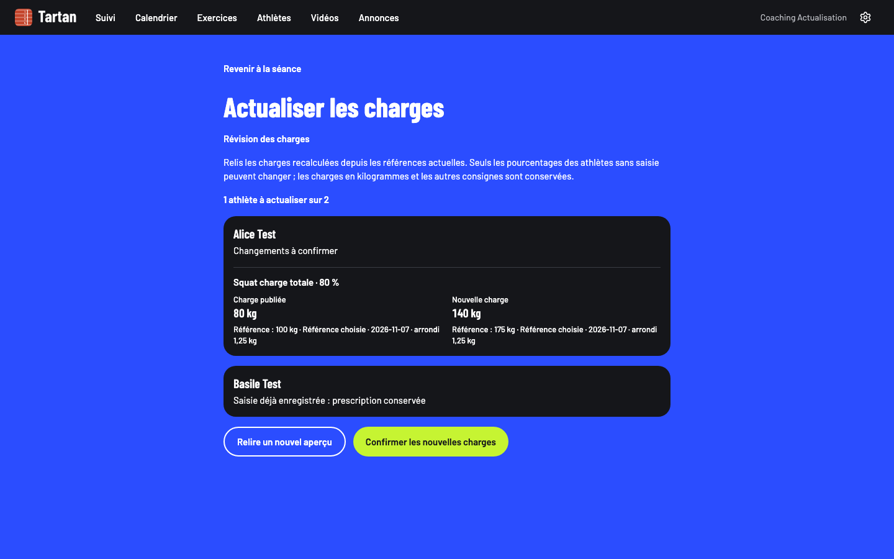

# Lot B — actualisation explicite des charges publiées

Code vérifié : `25557b06cc09079c15c601d797626bb707c017d5`, le 7 novembre 2026. Node 22.23.4, pnpm 10 via Corepack, Postgres jetable local 54329, bases `tartan_v11_test` et `tartan_v11_e2e`. Aucun changement de schéma, aucune activation ni mutation de prescription en production.

## Parcours livré

Depuis le suivi d’une séance publiée ou le constructeur web, le coach ouvre « Actualiser les charges ». Le suivi natif ouvre le même parcours via l’API partagée. L’aperçu montre les athlètes à actualiser en premier, la charge publiée et proposée, le pourcentage, la valeur et l’origine de référence, la date et le pas d’arrondi. Une source modifiée reste visible même si l’arrondi produit les mêmes kilos.

Seuls les pourcentages des prescriptions individuelles déjà figées et sans saisie sont actualisables. Les kilogrammes absolus, consignes, adaptations, séries et cibles RPE/RIR sont conservés. Une convention incompatible est signalée et n’est pas convertie ; une référence absente affiche « Charge à définir ». Les athlètes ayant déjà une saisie, même simple ou partielle, gardent leur prescription historique. Une ancienne prescription non figée n’est pas reconstruite depuis un maximum récent.

Le coach peut annuler le dialogue sans écriture. La confirmation recontrôle l’espace, le rôle, l’auteur pour les adjoints et les groupes autorisés. Le jeton d’aperçu couvre la version, l’audience, les copies et les sources ; une modification entre aperçu et confirmation exige une relecture. Deux confirmations concurrentes créent une seule révision. Une requête rejouée avec l’ancienne version est refusée, sans nouvelle copie ni notification.

La transaction enregistre la nouvelle version, les seules copies modifiées, la trace d’audit et les notifications des seuls athlètes concernés. Les valeurs de force et données santé ne figurent ni dans la notification ni dans l’audit. L’envoi se fait après commit et respecte les heures calmes ; une panne d’envoi laisse la notification durable au cron. Une panne d’insertion de copie ou de notification annule la révision entière.

## Preuves

- Suite serveur complète : **477 tests réussis**. Après l’ajout du tri de l’aperçu et du test d’échec de mise en file : **32 tests ciblés réussis** (23 prescriptions figées/actualisation et 9 notifications). La suite complète n’a pas été répétée après ces derniers ajustements ; la CI du nouveau commit est requise.
- **98 tests domaine et 160 tests mobiles réussis**. Adaptations en pourcentage, charges absolues, absence de maximum, source différente à kilos identiques et conventions incompatibles couverts.
- Cas serveur : publication/validation historique conservée, 120 athlètes, concurrence, panne SQL, reprise, arrivée d’un destinataire après aperçu, référence changée, saisie arrivée entre aperçu et confirmation, désactivation du drapeau, autre espace, athlète interdit, adjoint non auteur et accès révoqué.
- **Deux parcours Playwright sur build de production réussis**, 390 et 1440 px : entrée depuis le suivi, annulation sans écriture, conflit de référence réel, nouveau calcul, confirmation, réalisé d’un autre athlète inchangé, accès athlète refusé et rechargement sans nouvel effet. Axe et absence de débordement passent, avec vérification supplémentaire à 768 px et zoom 200 %.
- Le premier essai Playwright échouait sur un sélecteur `role=alert` ambigu avec l’annonce de route Next.js. Le conflit applicatif était bien affiché ; le sélecteur a été précisé. Les deux reprises passent, dont la dernière sur le tri final de l’aperçu.
- Types du monorepo réussis sur le code final. ESLint web : zéro erreur, quatre avertissements préexistants. Impeccable : zéro travers.
- Exports Hermes iOS et Android réussis. Aucune preuve de build signé, de réception push réelle, de VoiceOver/TalkBack ou d’essai physique revendiquée.

Les passes UI/UX ont retenu la comparaison avant/après, la confirmation et les erreurs annoncées. Les composants et jetons existants sont conservés ; la nouvelle direction artistique globale appartient au lot A. La relecture React garde les contrats partagés, les chargements groupés côté serveur et les états de confirmation isolés par espace/séance/compte.

Commandes principales, sous Node 22.23.4 :

```sh
TEST_DATABASE_URL=postgresql://tartan@localhost:54329/tartan_v11_test corepack pnpm --filter @tartan/web test
TEST_DATABASE_URL=postgresql://tartan@localhost:54329/tartan_v11_test corepack pnpm --filter @tartan/web test tests/frozen-prescriptions.test.ts tests/notifications.test.ts
corepack pnpm --filter @tartan/domain test
corepack pnpm --filter @tartan/mobile test
corepack pnpm -r --if-present typecheck
E2E_PROD=1 E2E_DATABASE_URL=postgresql://tartan@localhost:54329/tartan_v11_e2e corepack pnpm --filter @tartan/web test:e2e e2e/refresh-loads.spec.ts
corepack pnpm --filter @tartan/web lint
corepack pnpm design:check
corepack pnpm --filter @tartan/mobile exec expo export --platform ios --output-dir /tmp/tartan-v11-refresh-ios --max-workers 2
corepack pnpm --filter @tartan/mobile exec expo export --platform android --output-dir /tmp/tartan-v11-refresh-android --max-workers 2
```

## Capture

Compte et valeurs fictifs, aperçu avant confirmation.



La recette physique reste ouverte. Les lots A, C, D et E ne sont pas livrés par ce changement. L’IA et la progression restent désactivées par défaut ; cette preuve ne vaut pas autorisation d’ouverture commerciale.
