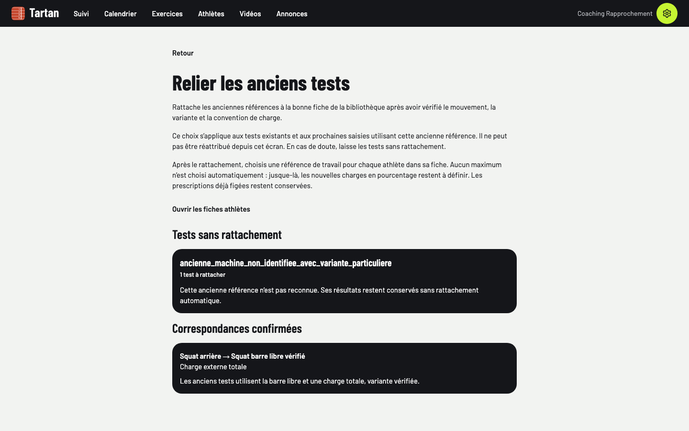
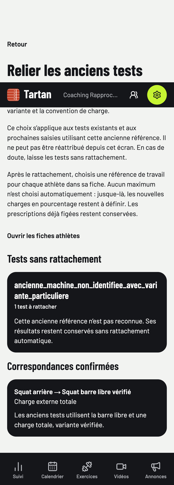

# Lot B — rapprochement des anciens tests de force

Code vérifié : `7519866005f3778e35917a5660e9081dd5cbb59f`, le 7 novembre 2026. Node 22.23.4, pnpm 10 via Corepack, Postgres local 54329 ; bases jetables `tartan_v11_test` et `tartan_v11_e2e`. Aucune migration, aucun rattachement de données réelles ni activation en production.

## Parcours

Depuis les réglages, le propriétaire d’un espace avec progression activée peut consulter les anciennes clés non liées et leur nombre de tests. Il choisit une fiche compatible, voit sa convention et ses consignes, décrit sa vérification et confirme le mouvement/la variante/la convention. Un dialogue rappelle la correspondance et son effet avant l’écriture. Aucun exercice n’est présélectionné.

Les clés inconnues restent affichées sans action de rattachement. Les fiches d’assistance ou de poids du corps seul sont exclues. Les correspondances déjà confirmées affichent le nom de la fiche, la convention et le motif ; elles ne peuvent pas être réattribuées depuis cet écran. Le service conserve l’idempotence, les conflits et l’audit existants.

Le rattachement ne choisit aucune référence de travail. L’interface indique que le coach doit la choisir sur chaque fiche athlète ; jusque-là, les nouvelles prescriptions en pourcentage liées à cette référence restent à définir. Les prescriptions déjà figées sont conservées. Le parcours natif utilise le même contrat et la même API, avec recherche d’exercice et confirmation native.

## Preuves

- **11 tests serveur ciblés** des références : rattachement explicite/idempotent/audité, concurrence, accès, conventions, référence choisie et rapport enrichi avec nom et convention.
- Typecheck complet du monorepo réussi ; nouvelle vérification native après les derniers ajustements de messages d’erreur.
- **Deux parcours Playwright de production** réussis : propriétaire depuis les réglages, refus de lecture par l’athlète, absence de sélection initiale, motif/confirmation obligatoires, annulation sans écriture, rattachement, conservation d’une clé inconnue longue et absence de sélection automatique d’un maximum. Relecture après rechargement.
- Axe et absence de débordement vérifiés à 390, 768 et 1440 px ; zoom 200 % sans débordement. La dernière exécution couvre aussi une clé inconnue longue de 58 caractères.
- ESLint web sans erreur (quatre avertissements préexistants), Impeccable sans travers.
- Exports Hermes iOS et Android réussis avec les écrans et les erreurs près des champs. Pas de build signé, de VoiceOver/TalkBack ni de téléphone physique revendiqué.

Les recherches UI/UX ont été resserrées sur la confirmation et les erreurs de formulaire : les propositions de landing/glassmorphism ne convenaient pas à cet écran d’administration. Les composants, jetons et polices Tartan existants sont conservés ; la nouvelle DA globale reste au lot A.

Commandes principales :

```sh
TEST_DATABASE_URL=postgresql://tartan@localhost:54329/tartan_v11_test corepack pnpm --filter @tartan/web test tests/strength-references.test.ts
corepack pnpm -r --if-present typecheck
corepack pnpm --filter @tartan/mobile typecheck
E2E_PROD=1 E2E_DATABASE_URL=postgresql://tartan@localhost:54329/tartan_v11_e2e corepack pnpm --filter @tartan/web test:e2e e2e/strength-mappings.spec.ts
corepack pnpm --filter @tartan/web lint
corepack pnpm design:check
corepack pnpm --filter @tartan/mobile exec expo export --platform ios --output-dir /tmp/tartan-v11-mappings-ios --max-workers 2
corepack pnpm --filter @tartan/mobile exec expo export --platform android --output-dir /tmp/tartan-v11-mappings-android --max-workers 2
```

## Captures

Comptes et résultats fictifs. La capture mobile est une page complète avec sa navigation fixe à la hauteur du viewport.





La CI du nouveau commit et la recette physique restent à observer. L’actualisation explicite des charges déjà prescrites reste à implémenter ; les historiques, records, phases, analyses et IA ne sont pas livrés par ce lot.
