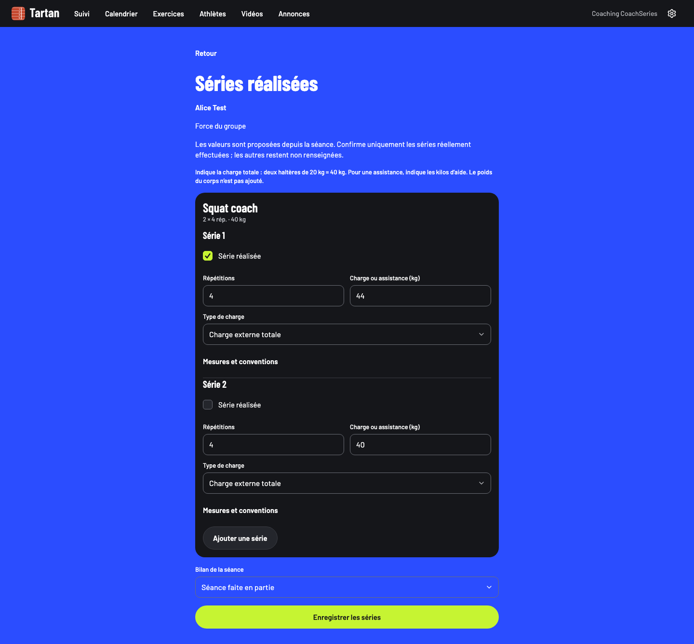
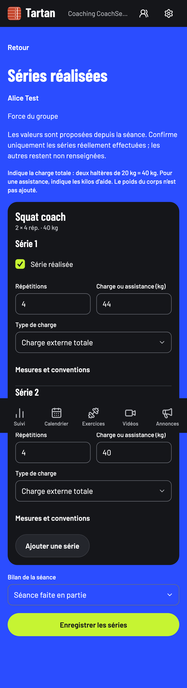

# Lot B — séries réalisées saisies par le coach

Code vérifié : `4d2df2c0d5a43c87a952d1d47ed8e2a78c18b247`. Date : 7 novembre 2026. Environnement local isolé, Node 22.23.4, Corepack/pnpm 10, Postgres local 54329. Bases jetables `tartan_v11_test` et `tartan_v11_e2e`. Aucune migration SQL ni activation en production.

## Comportement livré

Le suivi d’une séance publiée donne accès aux séries de chaque athlète, sur web et applications natives, si la progression est activée. Le coach utilise le même éditeur que l’athlète. Brouillons, mutations en attente et reçus de résolution sont isolés par compte, espace, séance et athlète. Un conflit ne bloque pas un autre athlète et ne modifie pas la carte personnelle du coach. La comparaison identifie l’athlète concerné et reprend une lecture serveur fraîche.

Un assistant peut consulter les réalisations des athlètes de son groupe mais ne peut écrire que sur ses propres séances. Le serveur contrôle cette restriction ; les écrans et relectures la reflètent. Le retrait d’accès conserve les valeurs locales et empêche leur réécriture automatique. L’auteur enregistré est celui qui saisit. Le retour de l’athlète et sa date de validation ne sont pas effacés par une correction de séries.

## Vérifications

- **470 tests serveur**, dont concurrence entre coach/athlète, droits assistant, autre groupe/espace, consentement et indépendance des versions entre deux athlètes.
- **94 tests domaine**, dont refus de reprise d’un brouillon ou d’un envoi après retrait du droit d’écriture.
- **160 tests mobiles**, dont persistance et reprise des envois coach, destination API correcte, résolution limitée au bon athlète et absence d’effet sur les cartes personnelles.
- Typecheck complet du monorepo réussi. ESLint web : zéro erreur, quatre avertissements préexistants. Impeccable : zéro travers.
- **Deux nouveaux parcours Playwright sur build de production**, 390 et 1440 px : brouillons Alice/Basile distincts, enregistrement de Basile pendant un conflit d’Alice, correction concurrente depuis le compte athlète, comparaison nommée, application explicite, conservation du retour, contrôle SQL de l’auteur, rechargement du brouillon résolu, Axe et zoom 200 % sans débordement.
- **Huit parcours de non-régression sur build de production** après correction de l’en-tête : séries et comparaison athlète en desktop/mobile, validation athlète et appel coach hors ligne sous Chromium/WebKit.
- Exports Hermes iOS et Android réussis, avec éditeur partagé, route coach et résolution des conflits. Ce ne sont pas des builds signés ni des essais sur téléphones physiques.

La première exécution du parcours coach desktop a révélé un chevauchement du bandeau de synchronisation avec Réglages. La règle `top-0` primait sur le décalage CSS de l’en-tête. Le décalage suit maintenant la hauteur réelle du bandeau par `ResizeObserver`, y compris lorsqu’il passe sur plusieurs lignes. Les deux parcours coach passent après correction ; le test vérifie aussi les rectangles du bandeau et de l’en-tête.

Commandes principales (préfixées par le PATH Node 22 du poste) :

```sh
TEST_DATABASE_URL=postgresql://tartan@localhost:54329/tartan_v11_test corepack pnpm --filter @tartan/web test
corepack pnpm --filter @tartan/domain test
corepack pnpm --filter @tartan/mobile test
corepack pnpm -r --if-present typecheck
corepack pnpm --filter @tartan/web lint
corepack pnpm design:check
E2E_PROD=1 E2E_DATABASE_URL=postgresql://tartan@localhost:54329/tartan_v11_e2e corepack pnpm --filter @tartan/web test:e2e e2e/coach-performed-sets.spec.ts
E2E_PROD=1 E2E_DATABASE_URL=postgresql://tartan@localhost:54329/tartan_v11_e2e corepack pnpm --filter @tartan/web test:e2e e2e/performed-sets.spec.ts e2e/sync-review.spec.ts e2e/terrain.spec.ts --grep "sans réseau|deux appareils|l'athlète confirme"
corepack pnpm --filter @tartan/mobile exec expo export --platform ios --output-dir /tmp/tartan-v11-coach-sets-ios --max-workers 2
corepack pnpm --filter @tartan/mobile exec expo export --platform android --output-dir /tmp/tartan-v11-coach-sets-android --max-workers 2
```

## Captures et limites

Ces captures utilisent des comptes fictifs et la DA existante. Elles ne valident pas la nouvelle DA du lot A. La capture mobile est une page complète : la navigation fixe apparaît à la hauteur du viewport de capture.





La recette native physique, VoiceOver/TalkBack, la CI du nouveau commit et les autres lots restent distincts. Dans le lot B restent notamment le rapprochement historique via interface et l’actualisation explicite des charges prescrites. L’historique et les records relèvent du lot C.
